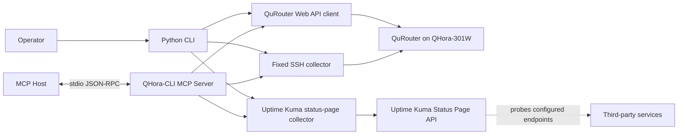

# 產品架構

## 1. 目標

QHora-CLI 在可信任的管理主機或 NAS 上提供 QHora-301W 的唯讀診斷入口。CLI 適合人工操作；stdio MCP Server 讓支援 MCP 的 host 以明確工具取得相同來源的摘要。路由器不執行 MCP daemon，也不需要安裝套件。

主要設計目標：

- 只提供有明確語意的唯讀操作，不提供通用 shell、URL fetch 或管理 proxy。
- 按來源選用 QuRouter Web API、SSH、Uptime Kuma；任一來源可單獨使用。
- 將資料來源錯誤與實際服務狀態區分，不以缺少資料表示健康。
- 不在 MCP response 中輸出密碼、Bearer token、SSH 私鑰或完整上游回應。
- 避免因韌體差異而推測未驗證的欄位與健康狀態。

## 2. 系統脈絡



MCP server 使用 stdio，不自行開 HTTP listener。CLI 與 MCP 共用 collector 函式；工具層只負責驗證輸入、呼叫 collector 與序列化結果。

## 3. 元件

| 元件 | 模組 | 職責 |
|---|---|---|
| CLI | `qrouter_cli/cli.py` | 解析 router、kuma 子命令並輸出 JSON |
| MCP transport | `qrouter_cli/mcp_server.py` | stdio JSON-RPC initialize、ping、tools/list、tools/call |
| QuRouter Web API | `qrouter_cli/web_api.py` | TLS、登入、固定 GET endpoint、欄位投影、登出 |
| SSH collector | `qrouter_cli/collectors.py::_ssh` | 使用 OpenSSH key、StrictHostKeyChecking 與固定命令 |
| Kuma collector | `qrouter_cli/collectors.py::kuma_status` | 讀 Status Page 與 heartbeat、正規化狀態、TTL/stale 快取 |
| Packaging | `pyproject.toml` | Python 版本、安裝 metadata 與 `qurouter` entrypoint |

Runtime 僅使用 Python 標準函式庫。SSH 透過作業系統 OpenSSH client 呼叫，不由 Python 套件內嵌 SSH transport。

## 4. 操作模式與依賴

| 模式 | 指令／MCP tool | 必要設定 | 不需要 |
|---|---|---|---|
| Web-only | `router web-status`／`qrouter_web_status` | `QROUTER_WEB_*` | Kuma、SSH |
| Kuma-only | `kuma status`／`qrouter_kuma_status` | `KUMA_BASE_URL`、`KUMA_STATUS_SLUG` | 路由器密碼、SSH |
| SSH-only | `router status`／`qrouter_router_status` | `QROUTER_HOST`、user、port、key、known_hosts | Web API、Kuma |
| 整合 | `router integrated-status`／`qrouter_integrated_status` | Web API + Kuma | SSH |

若不安裝 Kuma 且 SSH 停用，使用 Web-only 模式。若沒有 Kuma，integrated tool 會保留 Web API 結果並將 Kuma source 標成 unavailable；日常操作使用 `qrouter_web_status` 可避免混淆。

## 5. 資料流

### 5.1 QuRouter Web API

1. 讀取 operator 提供的環境變數或 password file。
2. 將密碼依設備 API 要求 Base64 編碼，`POST /v1/login`，固定 `force=false`、`remember_me=false`、`qid_login=false`。
3. 若設備指出有作用中的管理工作階段且未回傳 token，不重試 force login。
4. 使用短期 Bearer token 呼叫固定 endpoint：
   - `GET /v1/debugmode/information`
   - `GET /v2/network/ports_status`
   - `GET /v2/network/wan/status`
5. 只保留明確 allowlist 欄位；不回傳 overview 中的 site、WAN identity 欄位或未知欄位。
6. `POST /v1/logout` 並清除 process 中的 token。

目前實測的 QHora 韌體可提供 overview；Ports、WAN API 可能回傳 HTTP 519/API `-2`。這些區塊各自顯示 unavailable，overview 仍可回傳，整體為 partial。

### 5.2 SSH

呼叫端輸入只可選擇 section enum。每個 enum 對應 `SSH_COMMANDS` 中的固定字串；主機、連接埠和使用者只作為本機 `ssh` argv 欄位。連線使用 batch mode、指定 identity、known_hosts、host key strict checking、連線逾時及命令總逾時。單筆輸出上限 256 KiB。

SSH shell 已確認是非 root 管理帳號；不得將其當成可執行 sudo、讀 firewall 或寫系統分區的權限。

### 5.3 Uptime Kuma

以設定好的 status-page slug 讀兩個公開 endpoint：

- `/api/status-page/{slug}` 取得分組和 monitor metadata。
- `/api/status-page/heartbeat/{slug}` 取得最近 heartbeat。

Collector 以 monitor ID 對應 heartbeat，將狀態碼轉為 `up`、`down`、`pending`、`maintenance` 或 `unknown`。目前快取 TTL 預設 15 秒；短暫失敗可在 stale 上限內回傳最近成功快照。Kuma 頁面與 heartbeat 原始 response 不直接回傳 MCP。

第三方 API 可由 Kuma HTTP monitor 探測。此架構只讀 monitor 的健康狀態，不透過 Kuma 代理呼叫任意第三方 API。

## 6. 錯誤模型

| 狀況 | 呈現方式 |
|---|---|
| QuRouter login/API transport 失敗 | MCP tool error 或 Web API source unavailable |
| 個別 QuRouter endpoint 失敗 | 該 section `unavailable`；其他 section 繼續回傳，整體 `partial` |
| QuRouter 既有管理 session | 不強制登入；回報 session busy |
| Kuma 目前失敗且有近期成功快照 | `stale` 並標示 cache age/warning |
| Kuma 失敗且無可用快照 | Collector error，不以空清單當作正常 |
| SSH key、host key 或命令失敗 | MCP tool error；不改走密碼或任意 shell |

## 7. 部署與信任邊界

```mermaid
flowchart TB
  subgraph TrustedHost[Trusted management host / NAS]
    Env[Secret files and environment]
    Runtime[CLI or stdio MCP process]
  end
  Router[QHora-301W]
  Kuma[Uptime Kuma published page]
  Runtime -->|HTTPS preferred; optional explicitly enabled HTTP| Router
  Runtime -->|SSH key + pinned host key| Router
  Runtime -->|HTTP(S) read-only status-page API| Kuma
  Env --> Runtime
```

Secrets 應由 host secret manager、檔案 ACL 或容器 secrets 提供。MCP host 設定檔只放 secret file 路徑。Kuma 公開 Status Page 只應包含可公開的 monitor 名稱和狀態。此專案本身不包含持續服務、資料庫、歷史時序儲存或 Kuma monitor 管理功能。
